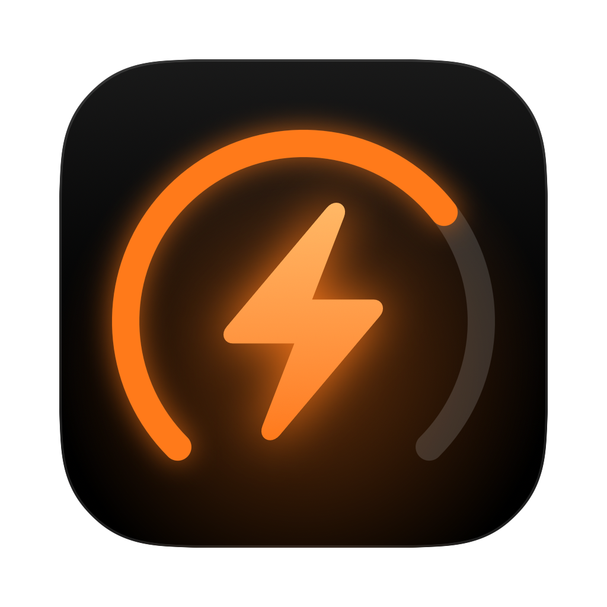
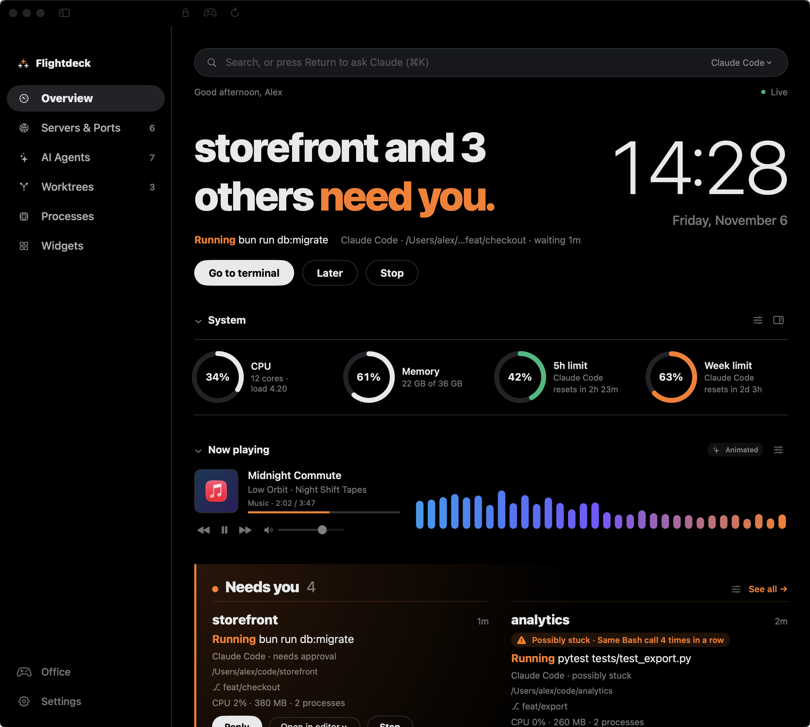
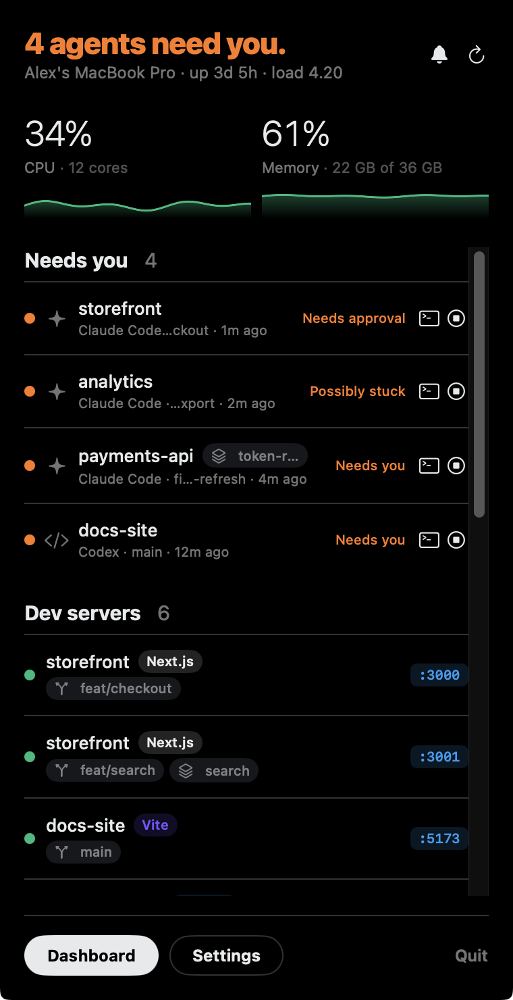
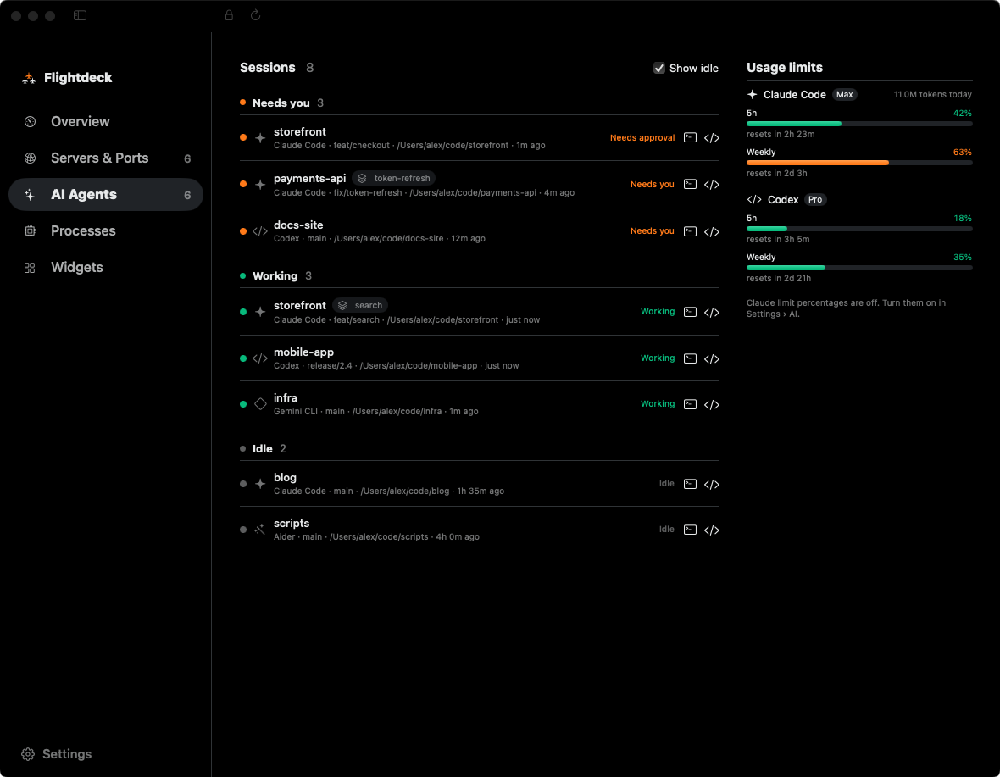
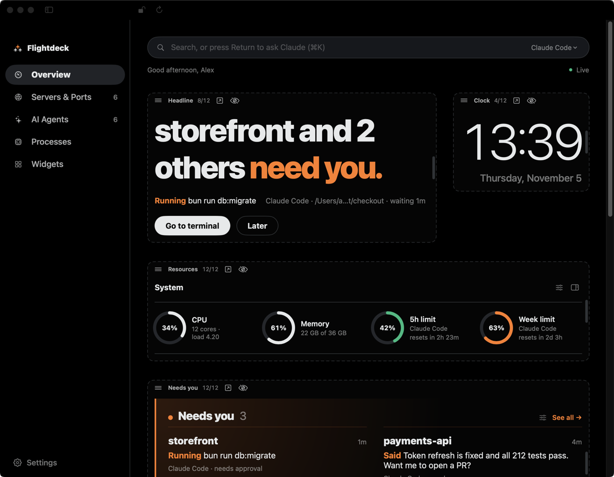
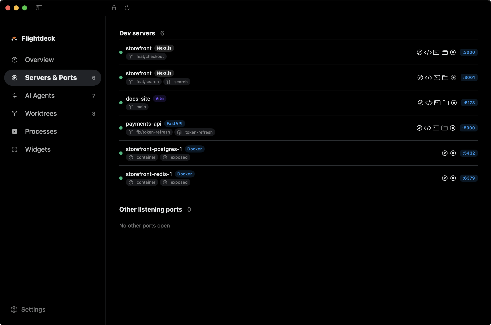
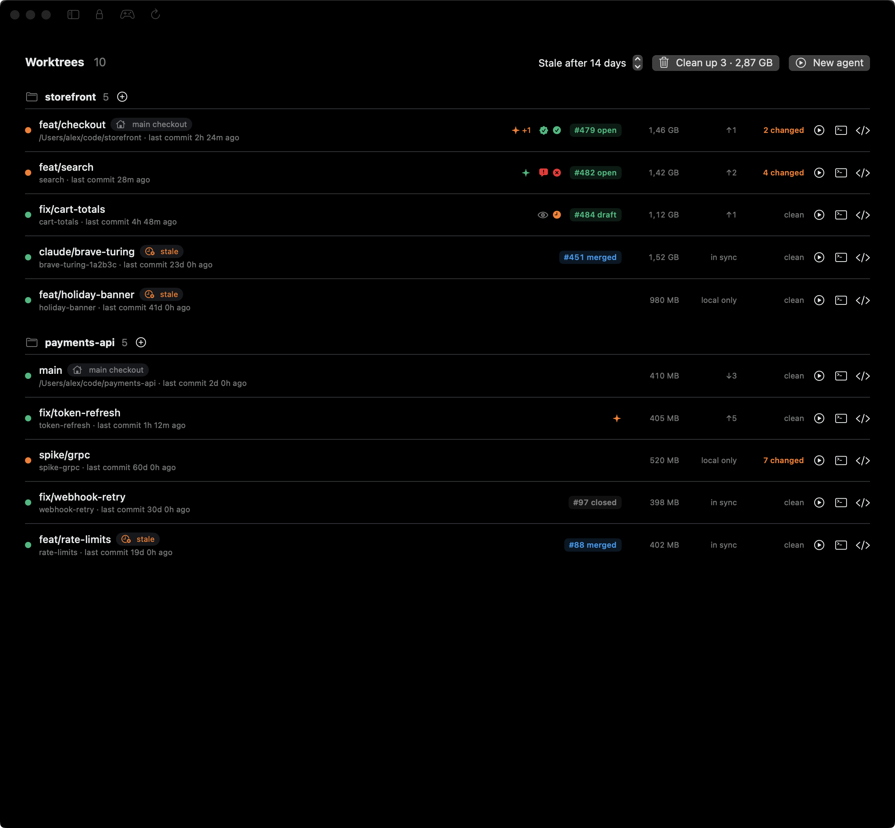
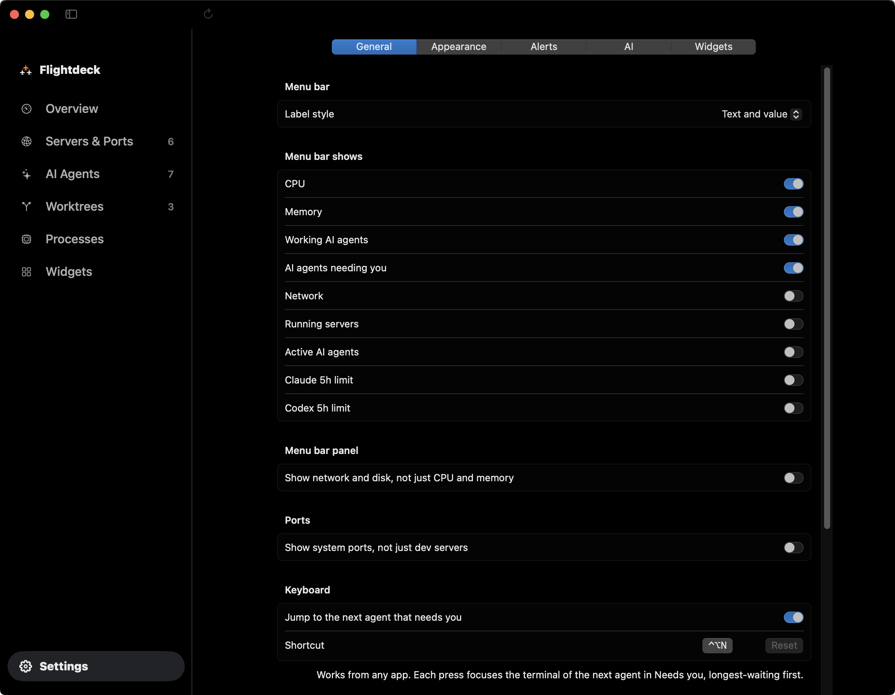
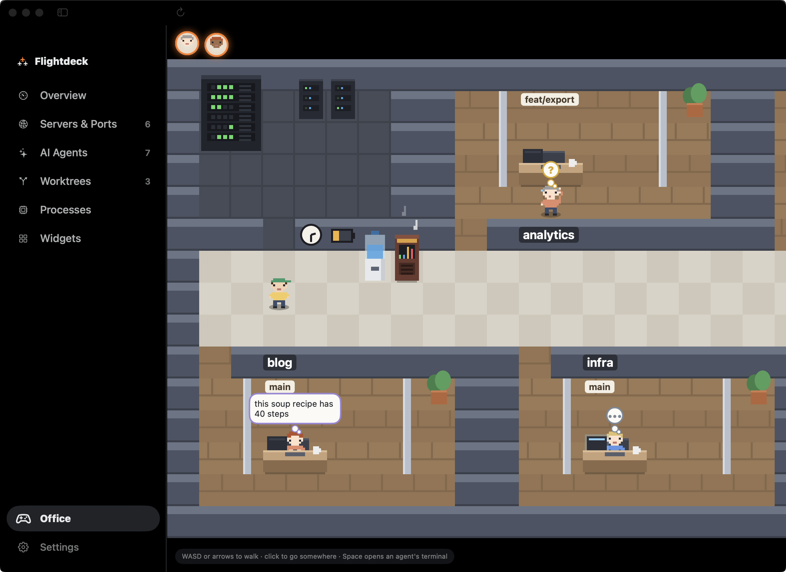
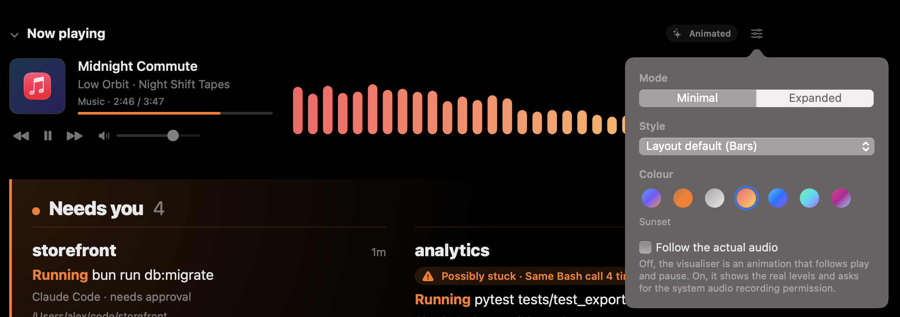

<div align="center">



# Flightdeck

**Agent and system monitor for developers.**

Flightdeck lives in the macOS menu bar and shows which AI agents are working, which are waiting on you and where, next to your dev servers and system resources.

**[flightdeck.pladsen.dev](https://flightdeck.pladsen.dev)**

[](https://github.com/MagnusPladsen/flightdeck/releases/latest)
[](https://github.com/MagnusPladsen/flightdeck/releases)
[](https://github.com/MagnusPladsen/flightdeck/stargazers)
[](https://github.com/MagnusPladsen/flightdeck/actions/workflows/ci.yml)
<br>


[](https://github.com/MagnusPladsen/homebrew-tap)

<br>

[](https://github.com/MagnusPladsen/flightdeck/releases/latest/download/Flightdeck.zip)

```bash
brew trust magnuspladsen/tap
brew install --cask magnuspladsen/tap/flightdeck
```

<br>



</div>

## Screenshots

| Menu bar panel | AI agents and usage limits |
|---|---|
|  |  |

| Rearrange any page | Dev servers by project |
|---|---|
|  |  |

| Worktrees and stale clean-up | Settings in the dashboard |
|---|---|
|  |  |

| The Office | Now playing |
|---|---|
|  |  |

Screenshots use demo data: start the app with `FLIGHTDECK_DEMO=1` to see the same.

## Features

- **System**: CPU, memory, network and disk, with live sparklines. Collapse the section when you don't need it.
- **Dev servers**: every listening port mapped to its git project, branch and worktree, with the framework detected (e.g. "Next.js · shop · worktree checkout · :3000"). Open in browser, editor or terminal, or stop the process.
- **AI agents**: which folders Claude Code, Codex and other agents are working in, and whether each is working, waiting for approval or waiting for you. Agents that look stuck (e.g. the same tool call over and over) get a badge with the reason and count as needing you. Cards can show CPU and memory for the agent and everything it started.
- **Agent controls**: Go to terminal focuses the agent's own Ghostty, iTerm2, Terminal or tmux tab; Stop interrupts it. Press ⌃⌥N anywhere to jump to the next agent that needs you (change the shortcut in Settings › General).
- **Worktrees**: every git worktree with its changes, ahead/behind, PR and the agent in it. Clean worktrees with no agent, no open PR and no commits for 14 days (adjustable) are marked stale, and Clean up removes them.
- **Alerts**: a notification when an agent needs you. Set quiet hours, or pause alerts from the bell in the menu bar panel; alerts held back arrive as one summary afterwards.
- **Usage limits**: Codex 5h and weekly limits from local logs; Claude token counts from local logs, and optionally Claude limit percentages.
- **Token spend**: optional, off by default. Estimated cost per project and model from Claude Code and Codex logs, with a daily budget alert. Turn it on in Settings › AI.
- **Ask Claude**: type a question in the overview's search bar and press Return, or press ⌘K anywhere in the dashboard. The answer opens in a palette with follow-ups, and agents it names open their terminal in one click. It runs your installed `claude` CLI with read-only tools and a snapshot of what the dashboard shows.
- **Office**: a walkable pixel-art office with a room per repo, where each agent is posed by what it's doing. Agents that need you show as bouncing avatars along the top, and a jukebox plays what's on. Walk up to an agent to go to its terminal or stop it. Open it from Office in the sidebar or the Visualize button.
- **Now playing**: what's playing in any player, with a visualiser in your theme's colours. Previous, play/pause and next, plus a volume slider for Spotify and Music. The adjust menu switches between Minimal and Expanded, five visualiser styles and six palettes. Live audio levels are opt-in; otherwise the bars follow play and pause. The section collapses like System.
- **Custom widgets**: shell commands shown as dashboard tiles.

Ships 13 layouts and 22 themes, and any theme works on any layout. Ignition is the default layout (a near-black agent board that leads with whichever agent needs you); the others are macOS, Terminal, Glass, Bento, Cockpit, Editorial, Neon, Agent focus, Projects, Zen, Mission control and Timeline. Each layout switches to the theme it was designed in, and Settings › Appearance lets you pick another theme (Clean Dark, Clean Light, "match system", Tokyo Night, Catppuccin, Dracula and other coding palettes). Built-in themes are read-only: copy one to make your own theme, which you can recolour, rename, duplicate and delete.

Settings is a dashboard page at the bottom of the sidebar, not a separate window.

A big clock sits beside the "needs you" headline on the overview; like every section it can be moved, resized or hidden. Hover a "Needs you" card and click its X to clear it until that agent does something new.

Every dashboard page can be rearranged: click the lock button in the toolbar, then drag sections to move them (also onto another page in the sidebar), drag their right edge to resize on a 12-column grid, or hide them and add them back from the tray. Locking saves a custom version of the layout, e.g. "Ignition (custom)"; Settings › Appearance resets it.

Flightdeck is macOS only for now. The core library already builds on Linux, but there is no Linux app yet.

## Install

```bash
brew trust magnuspladsen/tap
brew install --cask magnuspladsen/tap/flightdeck
```

Newer Homebrew versions only load casks from taps you trust, hence the first line.

Or download `Flightdeck.zip` from [Releases](https://github.com/MagnusPladsen/flightdeck/releases). The app is not notarized yet; if macOS blocks it, allow it under System Settings › Privacy & Security › Open Anyway.

Flightdeck updates itself with [Sparkle](https://sparkle-project.org): it checks daily once you allow it, and "Check for Updates…" sits in the menu bar panel footer and in Settings › General.

## Release

Add a `## <version> — <date>` entry to `CHANGELOG.md` and bump `VERSION` on `main`. The entry becomes the release notes, the site's Flight log and the What's new card the app shows once after it updates. `.github/workflows/release.yml` tests, builds a universal `Flightdeck.app`, signs the zip and writes `appcast.xml` with Sparkle's `generate_appcast`, publishes both as a GitHub release, uploads the appcast to the fixed `update-feed` release the app reads (`SUFeedURL`) and, when the `TAP_TOKEN` secret is set, updates `Casks/flightdeck.rb` in `MagnusPladsen/homebrew-tap` (first release copies `packaging/homebrew/flightdeck.rb` there).

The release needs the `SPARKLE_PRIVATE_KEY` secret: the EdDSA private key whose public half is `SUPublicEDKey` in `scripts/bundle.sh`. It lives in the login keychain under the `flightdeck` account of Sparkle's `generate_keys`.

## Requirements

macOS 14+, Swift 6 toolchain (Xcode 16+).

## Run

```bash
swift run Flightdeck
```

## Build the app bundle

```bash
scripts/bundle.sh
open Flightdeck.app
```

Launch at login and update checks only work from the bundled app, which embeds `Sparkle.framework`. The app icon is drawn by `scripts/make-icon.swift`; run `swift scripts/make-icon.swift` to regenerate `Resources/AppIcon.icns`.

## Test

```bash
swift test
```

See [docs/architecture.md](docs/architecture.md) for how it fits together.

## License

[MIT](LICENSE)
